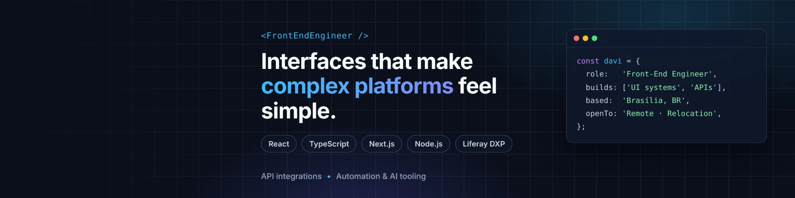

### Hi, I'm Davi 👋

Front-End Engineer from Brasília, Brazil. I build web software people rely on every day — currently leading the front-end of a government platform at **SEA Tecnologia** with React, TypeScript and Liferay DXP.

Outside work I ship complete products on my own, from database to UI to deployment, with a soft spot for **automation and AI**.

🌍 Open to remote roles and relocation.

---

#### 🛠️ Stack

**Front-end:** React · TypeScript · Next.js · JavaScript · HTML/CSS · Vite
**Back-end & data:** Node.js · Ruby on Rails · Python (FastAPI, Flask) · PostgreSQL · Supabase · REST APIs
**Enterprise:** Liferay DXP · FreeMarker · Groovy
**Tools:** Git · GitLab CI/CD · Docker · Linux · Vercel · LLM APIs

#### 🚀 Featured work

| Project | What it is | Stack |
|---|---|---|
| [**IMOWO**](https://github.com/daavisales/imowo-case-study) · [live](https://imowo.vercel.app) | AI financial assistant on WhatsApp for a consulting business — an LLM turns chat messages into validated transactions, plus reports and an admin panel | NestJS · Next.js · Prisma · Claude API |
| [**Trip Planner**](https://github.com/daavisales/trip-planning-project) | Personal study project — planning trips end to end | React · TypeScript · Vite |

#### 🤝 Collaborations

| Project | What it is | My role | Link |
|---|---|---|---|
| **NextEp** | Multi-tenant SaaS where an AI agent sells access to private Telegram communities: catalog, Pix payment and invite delivery | Seller dashboard, design system, QA (test suite 27 failing → 0) | [Case study](https://github.com/daavisales/nextep-case-study) |
| **Velora** | AI agent that qualifies WhatsApp leads and books appointments for service businesses | Front-end lead: scheduling UI, design system, owner dashboards | [Case study](https://github.com/daavisales/velora-case-study) |
| **Confia AI** (hackathon) | Public-transport reliability app for Brasília: trust index, "when to leave" and crowding, updated live | Built the in-app AI assistant end to end: LLM client, context builder, rate limiting, chat API and React chat widget | [Repository](https://github.com/a-Ferreira-ai/confiaai) |

#### 📫 Find me

[LinkedIn](https://www.linkedin.com/in/daavisales) · daviarmandosales@gmail.com
